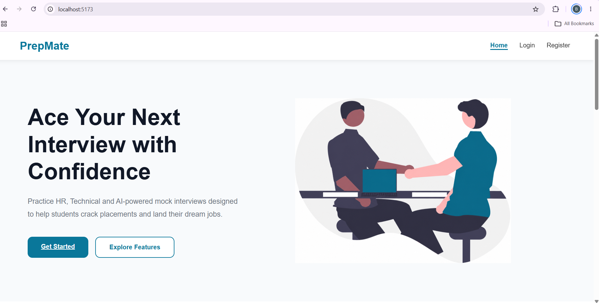
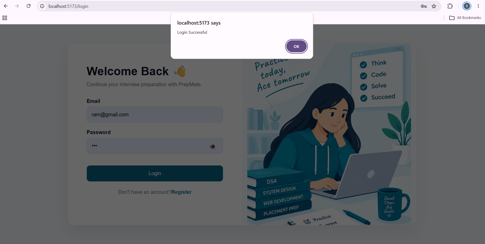
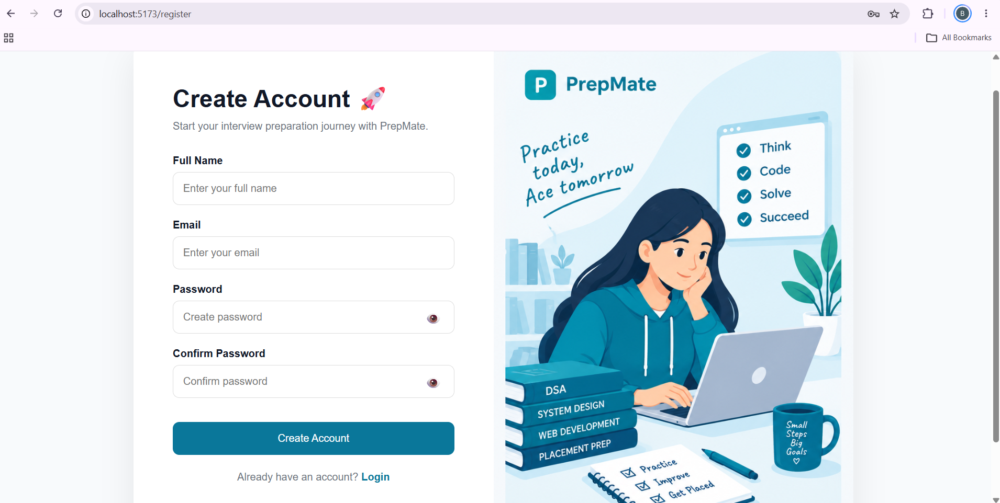
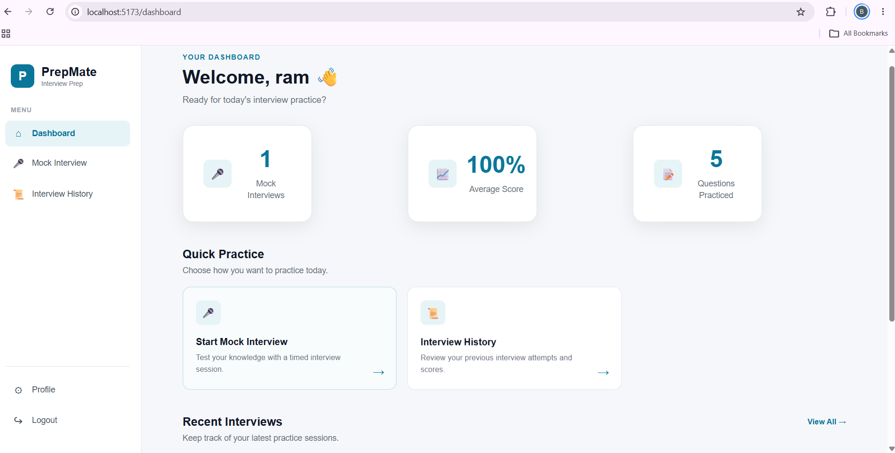
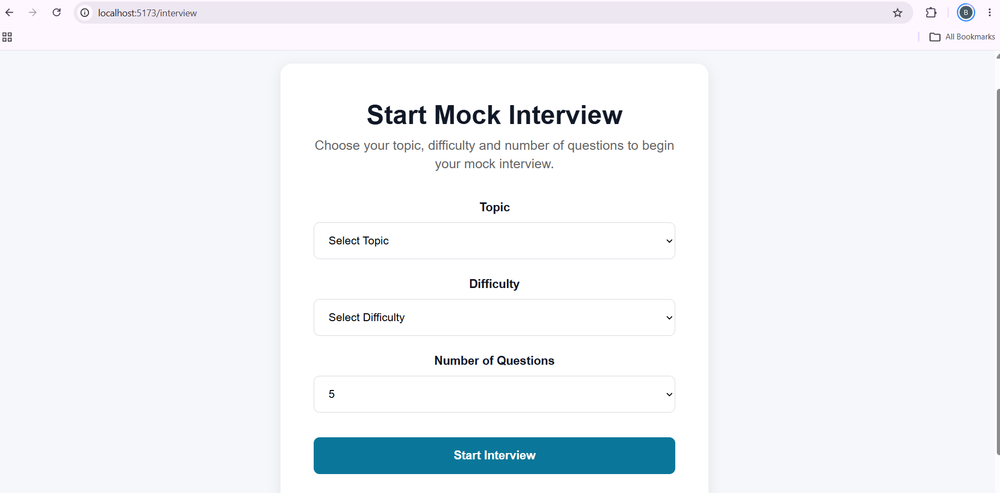
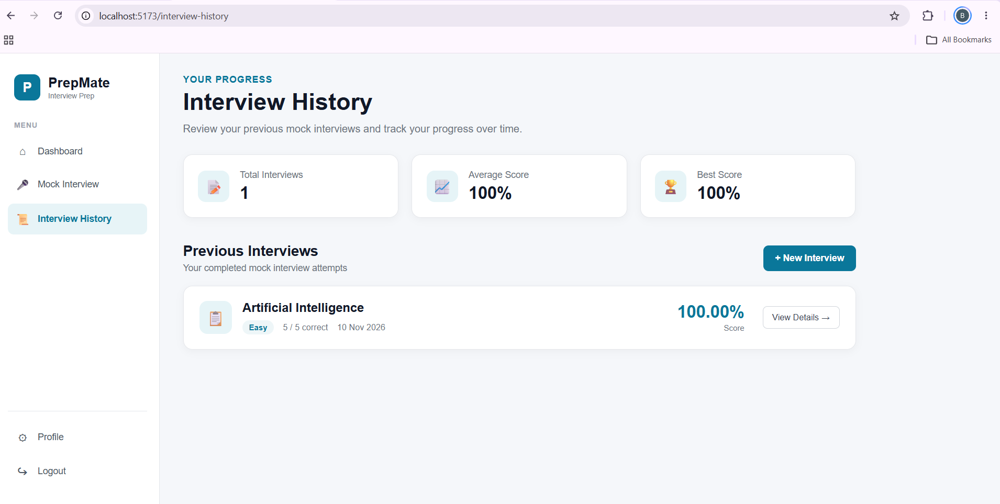
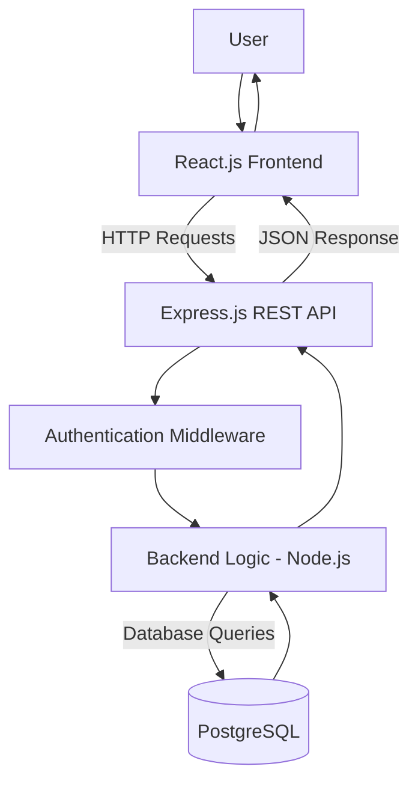

# PrepMate – Mock Interview Preparation Platform

PrepMate is a full-stack web application designed to help students prepare for technical interviews through topic-based mock interviews. It provides a platform where users can practice interview questions based on their selected topics and difficulty levels, while keeping track of their interview activities and progress.

## ✨ Features

- **User Authentication:** Secure user registration and login with password hashing and JWT-based authentication.
- **Personalized Dashboard:** A dashboard that welcomes users and provides access to interview preparation features.
- **Topic-Based Practice:** Practice interview questions based on selected topics.
- **Difficulty Selection:** Choose questions according to different difficulty levels.
- **Randomized Questions:** Dynamically retrieve randomized questions based on the selected topic and difficulty.
- **Interview History:** View previously conducted interviews.
- **Interview Details:** Access individual interview records and their details.
- **Protected Routes:** Restrict access to authenticated user pages.

## 🛠️ Tech Stack

| Category | Technologies |
|---|---|
| Frontend | React.js, Vite |
| Backend | Node.js, Express.js |
| Database | PostgreSQL |
| Authentication | JWT, bcrypt |
| Styling | CSS |
| API | RESTful APIs |
| Development Tools | VS Code, Postman, pgAdmin |

## 📸 Screenshots

### 1. Landing Page



### 2. User Authentication

**Login Page**



**Registration Page**



### 3. Dashboard



### 4. Interview Practice



### 5. Interview History




## 🏗️ System Architecture

PrepMate follows a client-server architecture in which the React frontend communicates with the Express.js backend through REST APIs. The backend handles application logic, authentication, and database operations using PostgreSQL.



## 📂 Project Structure

```text
PrepMate/
│
├── client/                  # React frontend
│
├── server/                  # Node.js and Express backend
│
├── screenshots/             # Application screenshots
│   ├── dashboard.png
│   ├── interview_history.png
│   ├── interview.png
│   ├── landing_page.png
│   ├── login.png
│   └── register.png
│
└── README.md
```

## ⚙️ Getting Started

Follow these steps to run PrepMate locally.

### Prerequisites

- Node.js
- npm
- PostgreSQL
- Git

### 1. Clone the Repository

```bash
git clone https://github.com/BhavanaMachapalli/prepmate.git
```

Navigate to the project directory:

```bash
cd prepmate
```

### 2. Set Up the Backend

Navigate to the server directory:

```bash
cd server
```

Install the dependencies:

```bash
npm install
```

Create a `.env` file inside the server directory and configure the required environment variables:

```env
PORT=5000

DB_HOST=localhost
DB_PORT=5432
DB_USER=your_postgres_username
DB_PASSWORD=your_postgres_password
DB_NAME=prepmate

JWT_SECRET=your_secret_key
```

### 3. Set Up the Database

1. Open PostgreSQL using pgAdmin or the PostgreSQL command line.
2. Create a database named `prepmate`.
3. Create the required tables using your database schema.

### 4. Start the Backend Server

```bash
npm run dev
```

The backend server runs at:

`http://localhost:5000`

### 5. Set Up the Frontend

Open another terminal and navigate to the client directory:

```bash
cd client
```

Install the dependencies:

```bash
npm install
```

Start the frontend development server:

```bash
npm run dev
```

The frontend runs at:

`http://localhost:5173`

## 🔄 Application Workflow

1. Users register for an account or log in using their credentials.
2. Authenticated users are redirected to their personalized dashboard.
3. Users select an interview topic and difficulty level.
4. The backend retrieves randomized questions matching the selected criteria.
5. Users can access their interview history and view individual interview records.

## 🚀 Future Enhancements

- Implement automated interview evaluation and scoring.
- Introduce detailed performance analytics.
- Provide personalized feedback and improvement suggestions.
- Enhance user profile management.
- Expand the question bank with additional topics and categories.

## 👩‍💻 Developer

**Bhavana Machapalli**

B.Tech – Computer Science and Engineering (AI & Data Science)  
SASTRA Deemed University

- GitHub: [BhavanaMachapalli](https://github.com/BhavanaMachapalli)
- Project Repository: [PrepMate](https://github.com/BhavanaMachapalli/prepmate)

---

*PrepMate is a personal project developed to strengthen full-stack development skills and explore practical solutions for interview preparation.*